# 1. Our mission

## Pillar 2: Green Capital Allocation & Portfolio Intelligence

**Focus:** Utilizing machine learning and market intelligence to optimize sustainable capital flows, forecast carbon-credit price trajectories, or balance risk/return in climate-screened investment portfolios.

**Guiding intent:** How can AI systems process market dynamics and climate indicators to direct capital toward verifiable sustainable investments?

Our mission is to make the route from a sustainability claim to an investment recommendation inspectable. Verdant Capital brings source evidence, dated market signals and explicit portfolio rules into a single research workspace. The aim is to support capital allocation that can be questioned, reproduced and justified, especially when evidence is incomplete or financial incentives conflict with sustainability concerns.

**Implemented scope.** This submission demonstrates a three-specialist investment simulator and a separate machine-learning assurance laboratory. It does not execute trades, approve loans, certify ESG claims, or establish real-world fraud-detection performance. Its carbon projection uses a carbon-related ETF proxy, not spot carbon-credit prices.

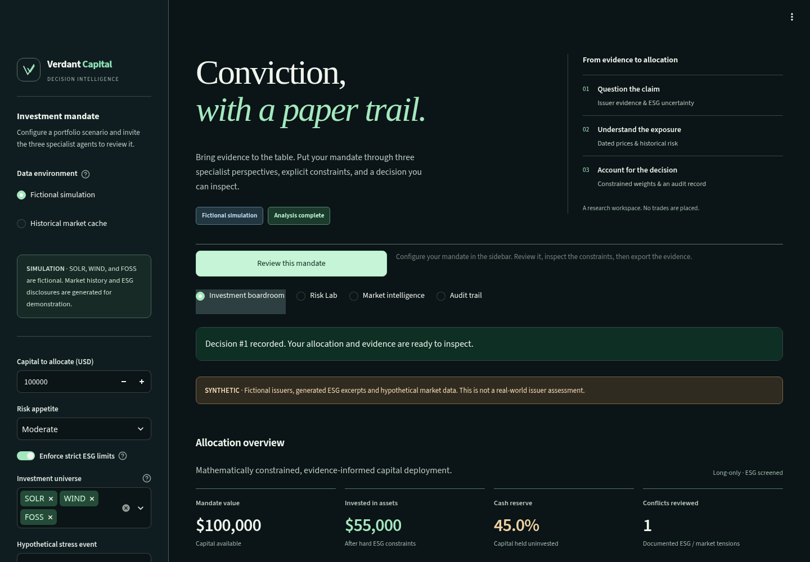{width=5.3in}

**How to read the flags:** **Implemented** identifies current behavior; **Synthetic** identifies generated evidence; **Assumption** identifies a chosen policy or economic input; **Limitation** identifies what the evidence does not establish. These distinctions apply throughout this report.

# 2. Problem statement

Climate-screened investment decisions combine information that is fragmented in both format and reliability. An issuer may publish an ambitious sustainability narrative without an independently supported baseline. Its market price may nevertheless rise. A portfolio decision must reconcile these signals without pretending that missing evidence proves misconduct or that price momentum verifies sustainability.

The practical problem is therefore broader than ranking assets. A useful system must answer: What evidence was available? Which signals were historical? What was inferred? Which investment rules were enforced? Why was an asset restricted, excluded or assigned zero weight? How costly is a mistaken risk flag compared with a missed adverse event?

| Problem | Consequence | Required response |
|---|---|---|
| Sustainability reports and market data are disconnected | Attractive narratives can obscure evidence gaps | Preserve issuer, document, page and date provenance |
| A language model can produce persuasive but unsupported numbers | Recommendations may be impossible to defend | Validate analysis and keep numerical allocation under a deterministic optimizer |
| Price upside can conflict with ESG concerns | Informal debate may override policy | Detect a specified conflict and resolve it through explicit constraints |
| Adverse events are rare | A model can achieve 99% accuracy by detecting nothing | Evaluate at 99:1 and emphasize precision–recall behavior |
| An anomaly flag can be difficult to interpret | Reviewers cannot explain an error or challenge a decision | Produce held-out feature attributions, including mistakes |
| False alarms and missed events have different costs | A statistically attractive threshold can be economically poor | Optimize a decision threshold using explicit monetary consequences |

**Formal decision question:** Given capital, a candidate universe, dated prices, available ESG evidence and a risk mandate, produce a long-only allocation plus a cash reserve, with a traceable explanation of every enforced rule.

**Mission boundary.** “Verifiable” is the intended standard for evidence-led investing. The current application provides traceability and uncertainty flags; it does not independently authenticate uploaded reports or prove that an investment is sustainable. Obtaining independently labeled issuer evidence is a necessary next step.

# 3. The solution we provide

## 3.1 A hybrid decision-intelligence workflow

Verdant Capital combines three specialist responsibilities. The **ESG Verifier** handles issuer evidence and uncertainty. The **Carbon & Market Analyst** summarizes dated market behavior and the available carbon-ETF outlook. The **Portfolio Optimizer** calculates weights under mathematical constraints. LangGraph coordinates these stages sequentially; review, synthesis and persistence are deterministic workflow steps rather than additional investment agents.

The product produces an investment memo, a policy ledger, specialist evidence, portfolio diagnostics and a downloadable JSON audit. Its separate Risk Lab supplies C02 rare-event evaluation, C06 attribution and C13 decision economics. Those benchmark outputs do not automatically become ESG ratings for the historical ticker portfolio.

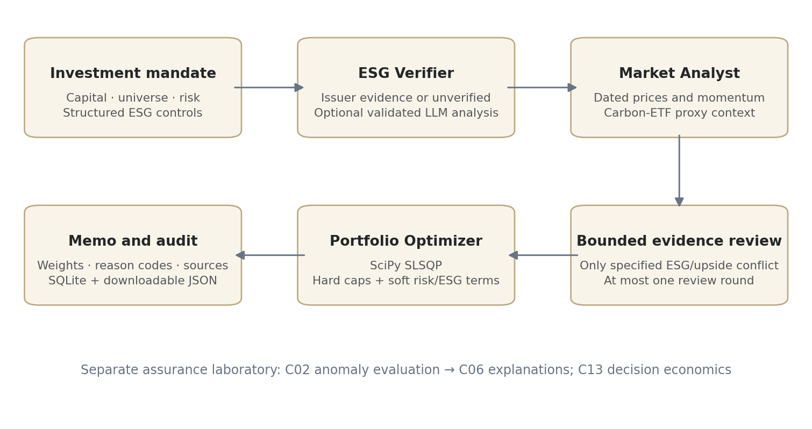{width=6.3in}

## 3.2 Inputs, data modes and contracts

| Input | Meaning and implemented handling |
|---|---|
| Capital | Finite USD amount from 0 to $100 million; converts weights to dollars |
| Candidate universe | At most 20 requested entries through the orchestration contract; deduplicated, normalized ticker symbols; CASH is reserved |
| Risk profile | Conservative, moderate or aggressive; changes risk penalty and general exposure limit |
| Strict ESG control | Applies high-risk exclusions and tighter unverified exposure caps |
| Investment principles | Recorded mandate text; arbitrary prose does not create a new mathematical constraint |
| Hypothetical event | Demo-only baseline, carbon-price spike, policy tightening or market selloff |
| Data mode | Explicit fictional simulation or historical market cache |

**Fictional mode — Synthetic.** SOLR, WIND and FOSS have predefined disclosure fixtures and deterministic generated prices. Per-asset seeds derive from the ticker hash, making histories reproducible. The price generator uses cumulative normal log returns over a fixed business-date grid. Hypothetical events modify only the last 30 observations; earlier history stays unchanged.

For example, the fictional market-selloff scenario progressively applies final price changes of −40% to SOLR, −32% to WIND and −45% to FOSS. These are selected scenario shocks, not measured market outcomes. Carbon-price-spike and policy-tightening scenarios are also predefined fictional changes; they do not infer causal carbon exposure from real companies.

**Historical mode — Implemented.** `yfinance.download` retrieves approximately one year of adjusted closing prices with `auto_adjust=True`. The default investment universe is NEE, ENPH, TSLA, XOM and ICLN; KRBN supplies the carbon-related ETF proxy. Prices are saved to a dated local CSV cache. A review reads that cache instead of fetching a streaming feed.

The loader normalizes supported yfinance layouts, converts numeric values, normalizes dates, removes invalid/duplicate date entries and replaces infinite prices with missing values. A malformed or missing cache fails closed. The optimizer separately checks whether each holding has usable positive finite history.

**Limitation.** Cached market data can become stale. The system does not automatically refresh it for each review, infer news, authenticate ESG claims from prices, or account for execution costs and liquidity.

## 3.3 ESG Verifier: evidence, scores and flags

ESG refers to environmental, social and governance considerations. In this implementation, the verifier assesses the credibility and possible inconsistency of sustainability disclosures. Its numerical scores are optional analyst/model estimates on a 0–100 scale; they are not certified third-party ratings.

### Evidence retrieval

In historical mode, the optional retrieval-augmented generation path works as follows:

1. Place permitted PDFs in `data_cache/pdfs/` with issuer names such as `NEE__2025_report.pdf`.
2. Extract text page by page using pypdf. Create approximately 850-character chunks with 120-character overlap; discard fragments shorter than 65 characters.
3. Preserve ticker, filename, page, report year, source mode and a page citation for each chunk. A content-derived identifier supports repeatable upserts.
4. Encode text using `all-MiniLM-L6-v2` sentence embeddings and store it in a persistent Chroma collection.
5. Retrieve up to five relevant chunks with an issuer filter. The final result is filtered again so another issuer’s metadata is not accepted.
6. If usable excerpts and an optional Gemini/OpenRouter provider are available, request structured ESG analysis grounded in those excerpts.

### Validated output contract

| Field | Allowed meaning / validation |
|---|---|
| `ticker` | Must agree with the requested issuer |
| `verdict` | `credible`, `mixed`, `likely_greenwashing` or `unverified` |
| `greenwash_risk` | Null or a numeric estimate from 0 to 100 |
| `esg_credibility` | Null or a numeric estimate from 0 to 100 |
| `confidence` | Value from 0 to 1; not independently calibrated |
| `reasoning` | Text, maximum 8,000 characters |
| `red_flags` | A list of at most 30 text entries |
| `evidence` | Replaced with registered retrieved citations, rather than accepting invented citation names |

A non-unverified verdict requires both scores and nonzero confidence. An unverified verdict forces null scores and zero confidence in the optional-model validation path. Missing evidence, an unavailable provider or an invalid response falls back to an explicit unverified assessment.

**Important flag:** `confidence = 0` means no supported classification confidence is asserted. It does not mean the issuer has zero sustainability, and a null score is not a numerical zero ESG rating.

### Fictional fixture example

| Demo issuer | Verdict | Credibility | Greenwash-risk estimate | Confidence |
|---|---|---:|---:|---:|
| SOLR | Credible | 84 | 16 | 0.86 |
| WIND | Unverified | Null | Null | 0.20 |
| FOSS | Likely greenwashing | 24 | 86 | 0.81 |

These are explicitly specified fictional fixtures, not measured performance of a learned ESG classifier. WIND’s fixture confidence is a demo specification; a missing historical assessment defaults to 0.

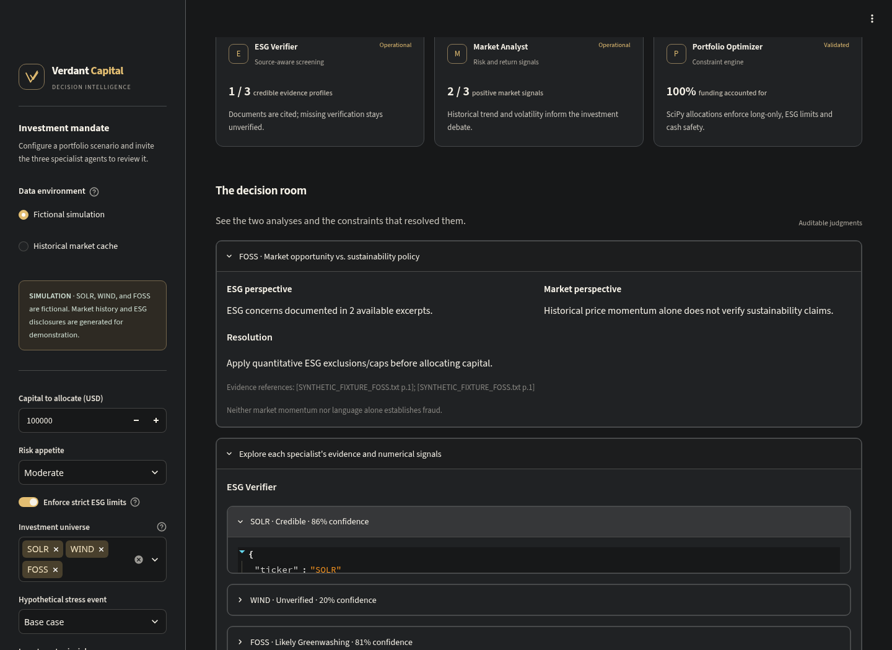{width=6.2in}

**Limitations.** Citation provenance establishes where text came from, not whether a report is true. Model schema checks reduce malformed output; they do not prove factual correctness or eliminate prompt injection. The six C02 features are not currently extracted automatically from these PDFs. A changed/deleted source PDF may require rebuilding the local index.

## 3.4 Carbon & Market Analyst: formulas and interpretation

Let $P_{i,t}$ denote the cached adjusted close for asset $i$ at observation $t$.

**Daily fractional return:**

$$r_{i,t}=\frac{P_{i,t}}{P_{i,t-1}}-1.$$

**Historical 30-session percentage change:**

$$R_{i,30}=100\left(\frac{P_{i,T}}{P_{i,T-30}}-1\right).$$

This requires 31 observations for 30 return intervals. It is a backward-looking change, not a return forecast. The 90-session direction compares the latest price with the price 90 intervals earlier and requires 91 observations.

**Annualized historical volatility:**

$$\sigma_{i,\mathrm{ann}}=\operatorname{std}(r_i)\sqrt{252}.$$

The displayed percentage multiplies this fractional volatility by 100. The market-statistics implementation uses the sample standard deviation.

| Rule | Output |
|---|---|
| $R_{i,30}>2\%$ | Bullish |
| $R_{i,30}<-2\%$ | Bearish |
| Otherwise | Neutral |
| Sufficient recent signal and at least 90 observations | Confidence 0.60 |
| Sufficient recent signal but fewer than 90 observations | Confidence 0.40 |
| No usable recent signal | Neutral, confidence 0 |

**Assumption flag.** The 2% decision band and 0.60/0.40 confidence levels are heuristics. “60% confidence” is not a validated 60% probability of future gains. A short-window bullish label can coexist with a longer-window declining trend.

### Carbon-related ETF projection

KRBN is a listed carbon-related ETF proxy. The code requires at least 65 positive finite observations and uses up to the latest 180. It fits a straight line to log prices:

$$\log P_t=a+bt,\qquad \widetilde b=\operatorname{clip}(b,-0.009,0.009).$$

The forecast is anchored to the latest actual price:

$$\widehat P_{T+h}=P_T\exp(\widetilde b h),\qquad h=1,\ldots,30.$$

The slope is fitted by ordinary least squares and then capped. Although the output calls the engine a regularized log-linear trend, there is no fitted ridge-regression penalty in this implementation.

With $s=\operatorname{std}(\Delta\log P-\widetilde b)$, the indicative band is:

$$\widehat P_{T+h}\exp\left(\pm1.28\max(s,0.0001)\sqrt h\right).$$

The 30-session projected change determines “rising” above +1.5%, “falling” below −1.5%, otherwise “stable.” A holdout diagnostic trains on earlier observations and compares the next 30 projections with the final 30 observed prices:

$$\mathrm{MAPE}=\frac{100}{H}\sum_{h=1}^{H}\left|\frac{P_h-\widehat P_h}{P_h}\right|.$$

**Limitations.** Bands are heuristic and not calibrated confidence intervals. Future dates use a weekday business-date grid, not an exchange holiday calendar. KRBN is not the spot price of a specific allowance or credit. Its projection supplies context and does **not** directly enter the portfolio optimizer.

## 3.5 Portfolio Optimizer: calculations and hard constraints

The optimizer combines price history, ESG assessments, risk preference and permitted agent-influence weights. It uses SciPy SLSQP. Neither an optional LLM nor a narrative memo writes the numerical portfolio percentages.

### Eligibility and estimation

An asset needs at least **45 positive finite price observations**. After aligning the eligible assets and dropping incomplete rows, the optimizer requires at least **30 common return observations**. Otherwise it retains all capital as cash.

The annual historical mean is clipped to reduce runaway estimates:

$$\mu_i=\operatorname{clip}\left(252\overline r_i,-0.30,0.30\right).$$

Annual covariance is shrunk toward its diagonal and regularized:

$$\Sigma_{\mathrm{raw}}=252\operatorname{Cov}(r),$$

$$\Sigma=0.8\Sigma_{\mathrm{raw}}+0.2\operatorname{diag}(\operatorname{diag}(\Sigma_{\mathrm{raw}}))+10^{-5}I.$$

Covariance captures joint movement, not just standalone volatility. These are historical estimates; neither clipping nor shrinkage guarantees future stability. Missing common-date rows may reduce usable history, and transaction costs are not modeled.

### Influence and soft ESG preference

Let $a_M$ and $a_E$ be market and ESG influence weights, each clipped to $[0.5,1.5]$. Let $c_i$ be ESG credibility; unknown credibility is treated as 0 **for this soft penalty only**:

$$q_i=0.06\,a_E\frac{\max(0,65-c_i)}{100},\qquad \widetilde\mu_i=a_M\mu_i-q_i.$$

With neutral ESG influence, an unverified asset receives a 0.039, or **3.9-percentage-point**, reduction in the objective’s annual return input. This is a chosen policy penalty, not an observed loss or a claim that missing evidence is fraud.

### Optimization objective

For portfolio weights $w$, including cash, the solver minimizes:

$$\mathcal L(w)=\frac{\lambda}{2}w^\top\Sigma w-\widetilde\mu^\top w.$$

Subject to:

$$\sum_i w_i=1,\qquad 0\leq w_i\leq u_i,\qquad 0\leq w_{\mathrm{cash}}\leq1.$$

The objective favors adjusted estimated return while penalizing variance. The upper bound $u_i$ comes from price eligibility and ESG/risk policy.

| Risk profile | Variance penalty $\lambda$ | General per-asset cap |
|---|---:|---:|
| Conservative | 22.0 | 35% |
| Moderate | 11.0 | 55% |
| Aggressive | 5.5 | 70% |

| Condition | Strict ESG enabled | Strict ESG disabled |
|---|---|---|
| Risk estimate >60 or likely-greenwashing verdict | Excluded: cap 0% | General profile cap if otherwise eligible |
| Missing risk assessment or unverified verdict | Cap 10% | Cap 20% |
| Otherwise assessed and eligible | General profile cap | General profile cap |
| Missing/insufficient/nonpositive/nonfinite prices | Cap 0% | Cap 0% |

**Constraint flag.** Turning strict ESG off removes the hard high-risk exclusion; it is not simply a visual preference. Sector exclusions, such as “no fossil fuels,” are not automatically inferred from company names or free-text principles.

### Solver verification and output

SLSQP starts at 100% cash, with up to 500 iterations and objective tolerance $10^{-10}$. Returned values must be finite, funded within $10^{-5}$, and within their bounds up to numerical tolerance $10^{-6}$. Failed/invalid solutions retain cash. Any rounding correction in weights is absorbed by cash, not by increasing a constrained asset.

For capital $K$:

$$\mathrm{Dollars}_i=K w_i,\qquad \sigma_p=\sqrt{w^\top\Sigma w}.$$

The displayed historical annual estimate uses $100\mu^\top w$. The separate adjusted objective estimate uses $100\widetilde\mu^\top w$. These are not interchangeable and neither guarantees future return. Cash defaults to zero modeled return and zero covariance; cash yield, inflation and execution costs are not represented. Dollar amounts are rounded to cents for the memo. Tiny solver values below $10^{-8}$ are suppressed in the presentation only.

The memo also reports a credibility average over assessed holdings only. For the set $V$ of holdings with a non-null credibility score:

$$C_{\mathrm{assessed}}=\frac{\sum_{i\in V}w_ic_i}{\sum_{i\in V}w_i},$$

when the denominator is positive; otherwise the field is null. Cash and unverified scores are excluded from this average. **Coverage flag:** a high assessed-only average does not mean the entire portfolio has verified ESG coverage; the soft penalty still treats unknown credibility as 0 for its separate calculation.

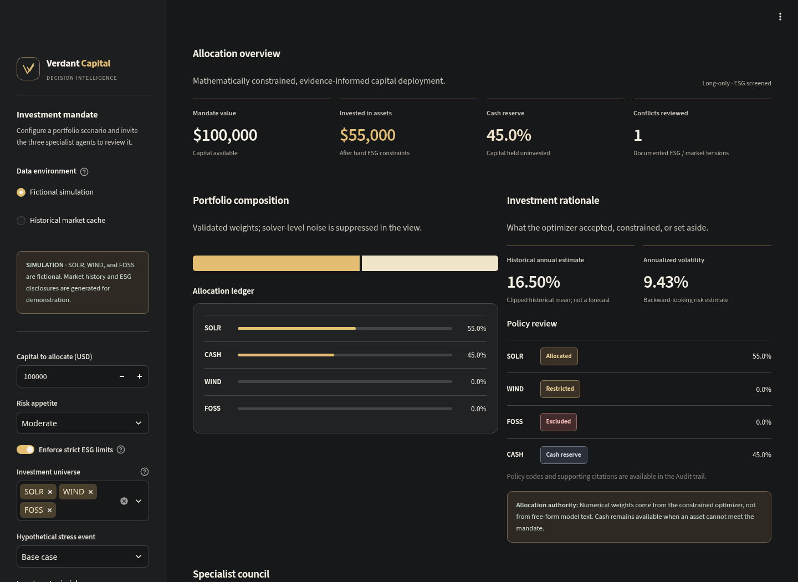{width=6.2in}

### Explaining the historical allocation supplied by the user

The following weights came from the user’s historical review. They were **not recomputed from a current price cache in this report**; they illustrate the effect of the implemented policies rather than independently verified current performance.

| Holding | Weight | Dollars on $100,000 |
|---|---:|---:|
| NEE | 0.5810% | $581.04 |
| ENPH | 2.9121% | $2,912.11 |
| TSLA | Approximately 0% | $0.00 |
| XOM | 10.0000% | $10,000.00 |
| ICLN | 0% | $0.00 |
| CASH | 86.5068% | $86,506.85 |

All five ESG assessments were unverified, so strict mode capped each at 10%. That alone limits total risky exposure to 50%, forcing at least 50% cash. The objective then selected still less exposure: approximately 13.5% invested and 86.5% cash.

XOM’s 10% does not mean verified sustainability; it means its unverified exposure reached the allowed cap. Tesla’s tiny value, approximately $2.37\times10^{-17}$ in fractional-weight form, is numerical noise rather than a meaningful allocation. Zero weight in an eligible holding is not automatically an ESG exclusion.

## 3.6 Conflict review, audit and feedback

The implemented conflict requires **high ESG risk or a likely-greenwashing verdict together with a bullish market view**. Unverified ESG alone does not trigger that conflict. “No conflict detected” therefore means no case matched this rule, not that all evidence agrees or that the portfolio is sustainable.

At most one review round records both perspectives, available citations, residual uncertainty and the resolution: enforce quantitative exclusions/caps before allocating. It does not invent new facts or override the optimizer. A deterministic synthesis builds the final memo, validates full funding and checks that no unrequested holding entered the allocation.

| Policy reason | Interpretation |
|---|---|
| `EXCLUDED_HIGH_ESG_RISK` | Strict policy blocks the holding |
| `LIMITED_UNVERIFIED_ESG` | Missing verification limits exposure |
| `EXCLUDED_MISSING_PRICE_HISTORY` | Price eligibility is inadequate |
| `ALLOCATED_CONSTRAINT_VALIDATED` | A nonzero allocation passed the implemented rules |
| `ZERO_OPTIMAL_WEIGHT` | Eligible holding receives zero from the objective |
| `CASH_SAFETY_RESERVE` | Capital remains unallocated to risky assets |

SQLite stores timestamped recommendations and source-labeled outcomes. JSON exports preserve the current memo and workflow evidence. This is inspectable persistence, not a cryptographically immutable ledger or automatic regulatory compliance.

For an agent with $h$ correct labels among $n$ eligible outcomes, after at least three outcomes:

$$p_{\mathrm{smooth}}=\frac{h+2}{n+4},\qquad a=0.5+p_{\mathrm{smooth}}.$$

With insufficient data, influence is 1.0. Demo adaptation uses a separate synthetic feedback database. Historical mode admits only outcome records explicitly labeled `verified`; the application does not independently establish those labels or automatically match future realized returns. Influence changes soft preferences, never hard ESG exclusions.

# 4. Challenge C02 — Severe Class Imbalance / Rare-Event Stress

## 4.1 Directive and our response

**Directive:** Real-world climate catastrophes, loan defaults and fraudulent green transactions are rare. The required demonstration is a 99:1 negative-to-positive evaluation split, maintaining meaningful precision–recall performance without majority-class collapse.

**Our solution:** A reproducible synthetic disclosure-feature benchmark using Isolation Forest, untouched held-out evaluation, five seeds, precision–recall curves, threshold metrics, a majority-class baseline and top-1% review precision. The benchmark is **exactly 1% positive**, as requested; it does not establish performance at prevalence lower than 1%.

## 4.2 Dataset and model

Each trial generates 25,000 shuffled samples, then uses a stratified split into 20,000 training cases and 5,000 held-out cases. The evaluation set contains **4,950 negatives and 50 positives**. Seeds are 7, 13, 21, 34 and 55.

The six features are generated directly, rather than extracted from actual ESG reports:

| Feature | Synthetic negative distribution | Synthetic positive distribution |
|---|---|---|
| Vague language ratio | Normal(0.15, 0.05) | Normal(0.38, 0.22) |
| Sentiment gap | Normal(0.10, 0.05) | Normal(0.40, 0.24) |
| Missing baseline | Bernoulli(0.08) | Bernoulli(0.50) |
| No third-party verification | Bernoulli(0.10) | Bernoulli(0.62) |
| Capex backing ratio | Normal(0.55, 0.15) | Normal(0.32, 0.22) |
| Intensity anomaly | Normal(0.05, 0.05) | Normal(0.48, 0.30) |

Normal parameters are mean and standard deviation. These distributions intentionally differ between classes; they create a controlled stress test. They are not calibrated issuer populations, and the Gaussian “ratio” values are not clipped to physical 0–1 bounds.

The model has 200 trees, contamination 0.01, the specified random seed and parallel fitting. Training uses features without labels; labels are used for stratification and evaluation. The 1% contamination setting supplies an expected anomaly proportion rather than learning the true prevalence.

Isolation Forest isolates unusual observations using random partitions. Shorter expected isolation paths indicate greater anomaly. The exported score and native decision are:

$$s(x)=-\mathrm{decision\_function}(x),\qquad \widehat y=\mathbf1[s(x)>0].$$

The default zero threshold follows the fitted model’s contamination-based offset. A score is not a fraud probability. No SMOTE, supervised class-weighting or probability calibration is claimed.

## 4.3 Metrics and evidence

$$\mathrm{Precision}=\frac{TP}{TP+FP},\quad \mathrm{Recall}=\frac{TP}{TP+FN},\quad F_1=\frac{2PR}{P+R}.$$

PR-AUC is the trapezoidal area under the precision–recall curve. Average precision weights precision by recall increments; it is related to, but not identical to, trapezoidal PR-AUC. Undefined precision/recall cases are reported with the evaluation library’s explicit zero-division handling.

| Seed | PR-AUC | Average precision | Precision | Recall | F1 | TP / FP / FN / TN |
|---|---:|---:|---:|---:|---:|---|
| 7 | 0.957579 | 0.957820 | 0.886792 | 0.940000 | 0.912621 | 47 / 6 / 3 / 4,944 |
| 13 | 0.988818 | 0.988917 | 0.875000 | 0.980000 | 0.924528 | 49 / 7 / 1 / 4,943 |
| 21 | 0.973582 | 0.973738 | 0.958333 | 0.920000 | 0.938776 | 46 / 2 / 4 / 4,948 |
| 34 | 0.928751 | 0.929256 | 0.857143 | 0.840000 | 0.848485 | 42 / 7 / 8 / 4,943 |
| 55 | 0.942764 | 0.943120 | 0.933333 | 0.840000 | 0.884211 | 42 / 3 / 8 / 4,947 |

Mean PR-AUC is **0.9583**, with population standard deviation **0.0214** across these trials. Mean average precision is **0.9586**, mean precision **0.9021**, mean recall **0.9040** and mean F1 **0.9017**. These are cross-seed means, not metrics from an aggregated confusion matrix.

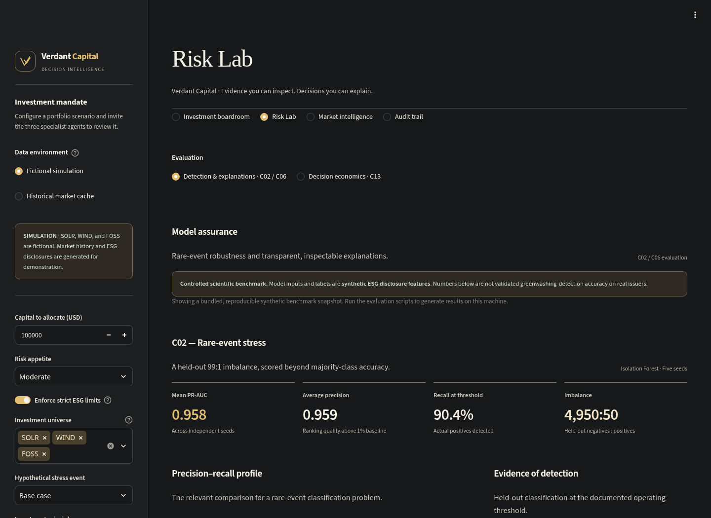{width=6.2in}

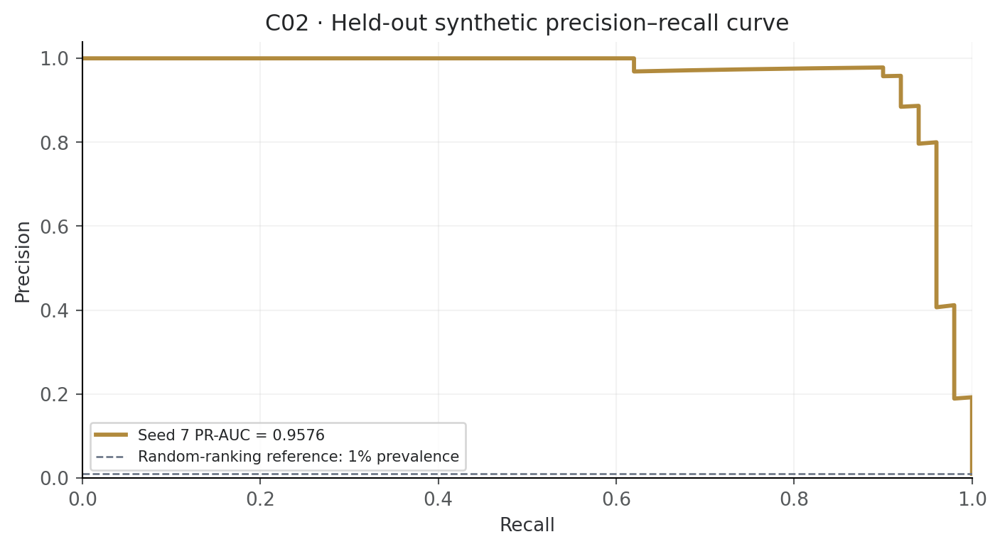{width=6.2in}

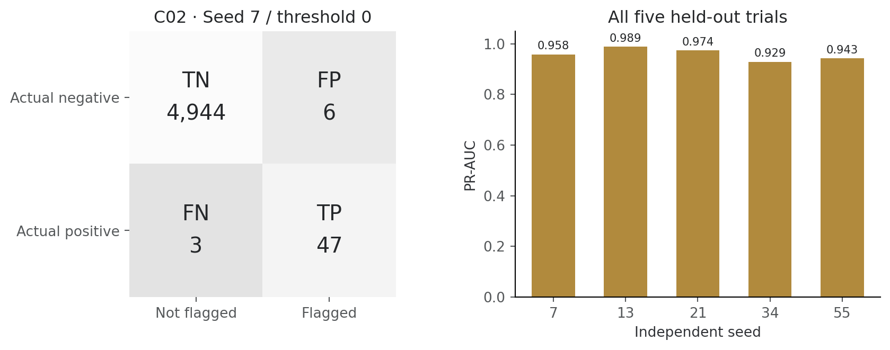{width=6.3in}

A model predicting every case negative would achieve 99% accuracy but recall 0 and no useful detection. In contrast, every evaluated seed has at least one true positive and at least one flag. That is the implemented anti-collapse gate. It is a necessary sanity check, not proof of production robustness.

The top-1% review budget selects 50 cases per evaluation split. Mean precision in that queue is **90%**, equivalent to **90×** the 1% random-selection baseline. This queue metric differs from precision at the model’s native zero threshold.

**Verification outcome:** C02 demonstrates non-collapse and strong PR performance on the specified synthetic 99:1 experiment. It does not demonstrate real-company greenwashing detection, catastrophe prediction or default prediction. Independent labels, issuer/time splits and real prevalence testing remain necessary.

# 5. Challenge C06 — Explainability & Feature Attribution

## 5.1 Directive and our response

**Directive:** A financial regulator demands documented justification for algorithmic approvals or rejections. The deliverable is feature-attribution plots for three edge-case decisions with the principal driving features identified.

**Our solution:** A regulatory-style research audit of the C02 seed-7 Isolation Forest specification, using permutation SHAP on three actual held-out synthetic observations. The decisions are **flag for review / not flagged**, not real credit approvals or legal findings. The portfolio has its own reason-code audit; C06 does not explain portfolio weights.

The pipeline refits the same seed-7 C02 training specification reproducibly. It selects distinct true-positive, false-positive and false-negative rows nearest the score boundary within each category. If a category is absent, it uses and explicitly labels a real borderline substitute rather than fabricating a misclassification. No substitution was needed in the reported run.

## 5.2 Explanation method and checks

Permutation SHAP explains the exported anomaly score using a background of 32 training rows sampled with the same seed. Six features and a `max_evals` budget of 39 are used in the standard explanation call.

For each observation:

$$f(x)\approx\phi_0+\sum_{j=1}^{6}\phi_j.$$

Here $\phi_0$ is the background/base score and $\phi_j$ is a feature’s contribution. Positive SHAP values increase the anomaly score; negative values reduce it. “Dominant feature” means largest absolute contribution. The code verifies reconstruction using relative and absolute tolerances of $10^{-4}$ before publishing a case.

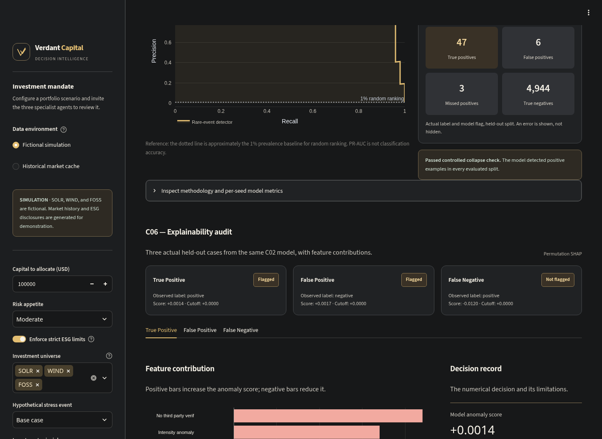{width=6.2in}

| Case | Held-out row | True / predicted label | Score | Primary feature | Primary SHAP contribution |
|---|---:|---|---:|---|---:|
| True positive | 3,960 | 1 / 1 | +0.00141556 | No third-party verification | +0.08814664 |
| False positive | 3,163 | 0 / 1 | +0.00174450 | Missing baseline | +0.10052287 |
| False negative | 4,256 | 1 / 0 | −0.01198364 | Missing baseline | +0.11141636 |

All three decisions use threshold 0. The reported base score is −0.22598368, and each reconstructed score matches its recorded model score to the shown precision.

## 5.3 The three edge cases

### Case 1: True positive — a correctly flagged synthetic case

The strongest upward contribution is absence of third-party verification, followed by the intensity anomaly. Together with other contributions, they move the score from a negative baseline to just above zero. The positive label and flag agree for this synthetic row.

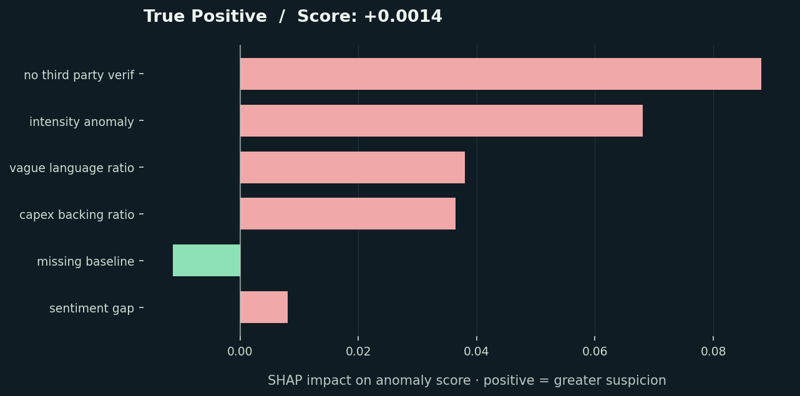{width=6.2in}

### Case 2: False positive — an unnecessary audit

The row’s true label is negative, but missing baseline and absent third-party verification push the score above the review threshold. This is an explicit model mistake. The explanation documents why it happened instead of presenting every flag as correct.

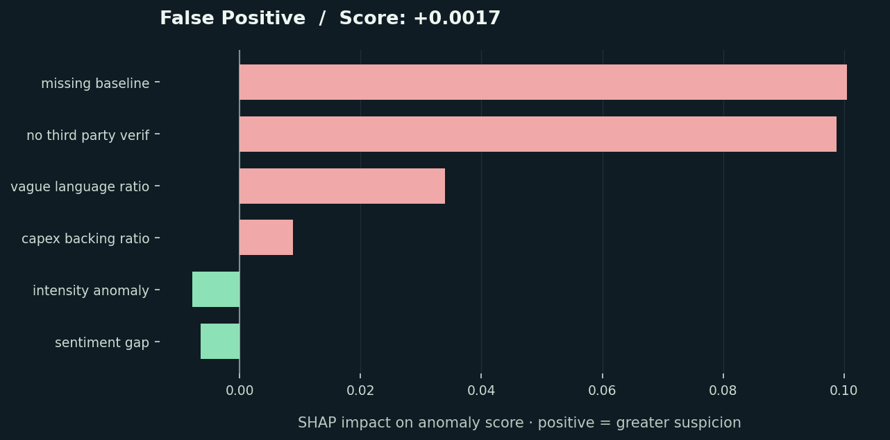{width=6.2in}

### Case 3: False negative — a missed positive

Missing baseline raises the score, but the sum of contributions is insufficient to cross zero from the background level. The final score stays negative even though the true synthetic label is positive. This case illustrates why false-negative economics matters in C13.

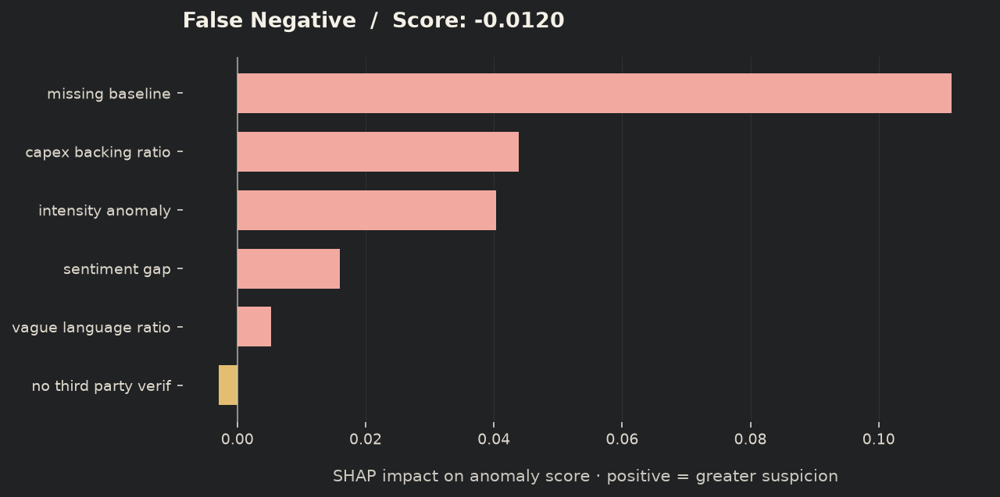{width=6.2in}

**Verification outcome:** Three genuine held-out cases, their feature values, labels, thresholds, contributions and additive reconstruction are documented. SHAP attributes a model score relative to a chosen background; it does not prove causality, authenticate an issuer disclosure, calibrate fraud probability or establish regulatory compliance. Feature dependence and background choice can affect the attribution.

# 6. Challenge C13 — Cost-Sensitive Threshold Optimization

## 6.1 Directive and financial assumptions

**Directive:** False positives incur manual audit overhead; false negatives can cause financial loss or defaults. The deliverable is an explicit financial cost matrix, a threshold optimized to minimize modeled economic loss, and the resulting confusion matrix.

**Our solution:** An exact validation-set search over anomaly thresholds, followed by a frozen-policy evaluation on untouched test cases. Costs are explicit, editable USD amounts per case. They are not inferred losses on the $100,000 investment portfolio.

The default illustrative scenario assumes **$100 per audit** and **$10,000 per missed positive**. For interpretation, $100 can represent two analyst hours at $50/hour; $10,000 can represent $25,000 exposure at 40% loss given default. These are selected scenario assumptions, not sourced operational measurements.

| Actual outcome | Not flagged | Flagged for manual audit |
|---|---:|---:|
| Negative | TN: $0 | FP: $100 |
| Positive | FN: $10,000 | TP: $100 |

A true-positive audit is assumed to prevent the modeled loss completely, while still incurring the audit cost. There is no recovery revenue, residual post-intervention loss, discounting or audit-capacity constraint in this scenario.

$$L(t)=(TP(t)+FP(t))C_A+FN(t)C_M.$$

$C_A$ is the audit cost and $C_M$ the missed-positive loss. Prevented loss is reflected in the TP cost rather than subtracted again as revenue. Savings are a difference between policy losses on the same cases; they are not a second benefit term.

## 6.2 Independent threshold selection

C13 uses the C02 generator/model **specification**, but fits a separate model from a 30,000-case pool. It is not the identical fitted model used for the 25,000-case C02 experiment.

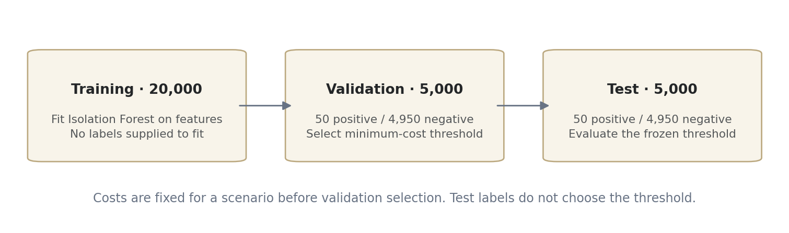{width=6.3in}

The split has 20,000 training, 5,000 validation and 5,000 test cases. Validation and test each contain 50 positives and 4,950 negatives. Seed 7 controls the initial model/data split; seed 8 controls the stratified validation/test partition.

The search evaluates every distinct validation score boundary plus a boundary immediately below the minimum score. The flag rule is strictly $s(x)>t$. Equal scores are never split. Audit-none and audit-all are included, so the search is exact over the available score-induced policies rather than an approximate threshold grid.

$$t^*=\underset{t\in\mathcal T_{\mathrm{validation}}}{\arg\min}\ L_{\mathrm{validation}}(t).$$

Equal losses prefer fewer audits, then the higher threshold. Sorted scores and cumulative counts give $O(n\log n)$ selection. No probability cutoff is assumed because the model score is not calibrated as a probability.

The chosen threshold is **−0.031598258945116586**. At that threshold, validation has TP 49, FP 35, FN 1 and TN 4,915: 84 audits cost $8,400 and one miss costs $10,000, for total validation loss **$18,400**.

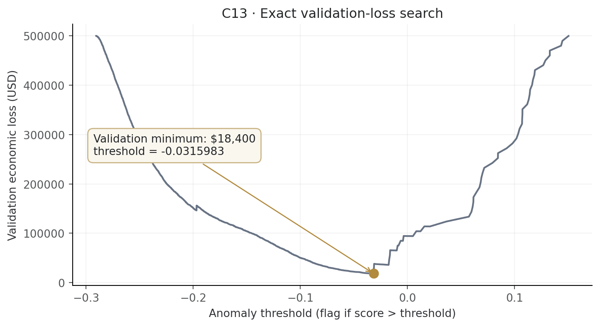{width=6.2in}

## 6.3 Held-out results and confusion matrix

The selected threshold is frozen before test outcomes are used to compare the policies:

| Test policy | TP | FP | FN | TN | Audits | Total economic loss |
|---|---:|---:|---:|---:|---:|---:|
| Default threshold 0 | 47 | 5 | 3 | 4,945 | 52 | $35,200 |
| Validation-selected threshold | 49 | 30 | 1 | 4,920 | 79 | $17,900 |
| Audit none | 0 | 0 | 50 | 4,950 | 0 | $500,000 |
| Audit all | 50 | 4,950 | 0 | 0 | 5,000 | $500,000 |

For the selected test policy:

$$L_{\mathrm{test}}=(49+30)\times100+1\times10{,}000=17{,}900.$$

For the default policy:

$$L_{\mathrm{default}}=(47+5)\times100+3\times10{,}000=35{,}200.$$

The modeled reduction is **$17,300**, approximately **49.15%** of default loss. The selected policy adds 27 audits, costing another $2,700, while avoiding two modeled misses worth $20,000. Precision decreases from 90.38% to 62.03%, but recall increases from 94% to 98%. This is the intended decision-economics tradeoff: maximizing precision is not the same as minimizing cost.

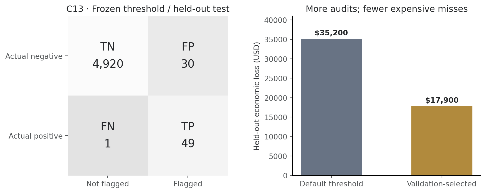{width=6.3in}

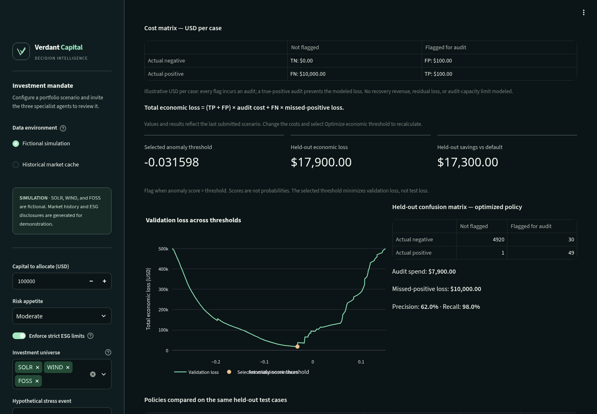{width=6.2in}

## 6.4 Sensitivity, verification and boundaries

The interface lets a reviewer change both costs and select **Optimize economic threshold**. The selected scenario has its own download identity and filename so its exported cost matrix matches the submitted values. Costs must be finite and nonnegative; the UI caps inputs at $1 billion and the numerical helper rejects amounts above $1 trillion.

Increasing missed-positive loss can justify additional audits and a lower threshold. Increasing audit expense can favor fewer flags. A minimum on validation does not guarantee a minimum on the test set or in production; negative held-out savings are retained. Repeatedly inspecting the same test set while exploring cost scenarios is sensitivity analysis, not fresh independent confirmation.

# 7. What we have achieved and how it is verified

Verdant Capital’s contribution is an integrated, inspectable process: uncertain evidence remains uncertain, investment policy is enforced numerically, model errors are shown, and the cost of an error is made explicit. The implementation separates claims that can be checked from assumptions that require validation.

| Deliverable | Evidence provided | Boundary |
|---|---|---|
| Green-capital research workflow | Actual three-specialist graph, constrained allocation, policy ledger and audit export | Research simulation; no execution or independent sustainability certification |
| C02 | Five synthetic 99:1 evaluations; mean PR-AUC 0.9583; visible errors and anti-collapse check | No real-issuer accuracy claim |
| C06 | Three held-out synthetic cases; SHAP plots, feature values and reconstruction | Explains anomaly scores, not causality or portfolio weights |
| C13 | Explicit USD matrix; validation minimum; fixed test policy; $17,900 versus $35,200 modeled loss | Costs and intervention effectiveness are assumptions |
| Technical reliability | 56 local tests, lint/format/compile checks, actual Streamlit smoke flows | Latest Windows fix requires its platform CI confirmation |
| Browser presentation | Four Chromium viewport sizes; automated accessibility checks; actual gold-theme screenshots | No full WCAG certification or verified Firefox/WebKit coverage |

The tests cover missing evidence, invalid capital/influence, unavailable or malformed price caches, empty/cash-only universes, ESG caps, bounded review, source-filtered feedback, economic threshold edge cases, atomic report writes and Windows-style file-contention recovery. Permanent file-write errors remain errors; the previous complete report is preserved.

The workspace defaults to loopback access with XSRF/CORS protection and disabled telemetry. It is a **single trusted operator tool**, with no login, tenant isolation or tamper-proof ledger. Public deployment requires additional controls.

**Performance flag.** The prior submission audit measured Lighthouse performance of 51 desktop and 13 under mobile throttling, below the requested 90+ target; accessibility and best practices scored 100. Framework bundles and layout shifts remain open work. The subsequent palette change was checked with tests and automated accessibility, not a new Lighthouse measurement.

# 8. Summary and conclusion

Pillar 2 asks how AI can use market dynamics and climate indicators to direct capital toward verifiable sustainable investments. Verdant Capital responds with a practical research architecture: evidence-aware ESG assessment, dated market interpretation, explicit numerical portfolio constraints and a reviewable decision record.

The three challenge demonstrations add complementary assurance. **C02** shows that the synthetic detector does more than predict the majority class. **C06** documents why three held-out decisions occurred, including a false alarm and a miss. **C13** shows how a transparent monetary loss model can select a different operating threshold and reduce held-out modeled loss despite lower precision.

The submission’s strongest supported claim is therefore **traceable, constraint-aware decision support with reproducible synthetic assurance evidence**. It does not yet establish a validated real-world ESG classifier, a reliable carbon-credit forecaster, superior realized investment returns or a production-regulated financial service.

The next milestones are independently labeled issuer evidence; tested document-feature extraction; issuer/time-separated evaluation; measured audit expense and intervention effectiveness; realistic portfolio backtests with execution costs; verified future outcomes; and authenticated deployment. Licensing remains explicitly pending at the owner’s request.

**Closing statement:** Capital allocation should be supported by evidence a reviewer can inspect, constraints a model cannot casually override, and economic assumptions that remain visible. Verdant Capital demonstrates that decision discipline and makes the remaining validation work explicit.

# Appendix A. Reproduction and evidence map

This report describes implementation baseline **501c33a** in `syedazoh/verdant_capital-`. Its screenshots use the charcoal/gold application, and its analytical figures are generated from the saved model results. The report adds documentation and visuals; it does not change investment or evaluation logic.

From the project root, with the development environment installed:

```powershell
.\.venv\Scripts\python.exe scripts/check.py
.\.venv\Scripts\python.exe -m challenge.c02_rare_event
.\.venv\Scripts\python.exe -m challenge.c06_explainability
.\.venv\Scripts\python.exe -m challenge.c13_cost_sensitive --audit-cost 100 --missed-loss 10000
.\.venv\Scripts\python.exe -m data.feedback_backtest
.\.venv\Scripts\python.exe -m orchestrator.graph
.\.venv\Scripts\python.exe -m streamlit run app.py
```

On Linux, use `.venv/bin/python`. Optional historical refresh is separate: `python -m data.fetch_market`, followed by `python -m data.carbon_forecast`. Optional report indexing is `python -m data.build_rag` after installing the RAG/provider extras and adding permitted source PDFs.

| Subject | Source / reproducible artifact |
|---|---|
| Orchestration, verifier and conflict rule | `orchestrator/graph.py` |
| Optional provider calls and prompt | `agents/llm.py`, `agents/prompts.py` |
| Issuer-scoped retrieval | `data/build_rag.py` |
| Historical data and price statistics | `data/fetch_market.py` |
| Carbon proxy projection | `data/carbon_forecast.py` |
| Objective, caps and numerical verification | `data/portfolio.py` |
| Outcome provenance and influence | `data/feedback_store.py` |
| C02 generator, fit and metrics | `challenge/c02_rare_event.py`; `data_cache/c02_report.json` and `c02_pr_curve.json` |
| C06 cases and plots | `challenge/c06_explainability.py`; `data_cache/c06_report.json` and `c06_plots/` |
| C13 cost search and evaluation | `challenge/c13_cost_sensitive.py`; `data_cache/c13_report.json` |
| Evidence underlying this report | `docs/report_assets/report_evidence.json`; `c13_validation_curve.csv` |
| Current visual evidence | `docs/screenshots/` and `docs/report_assets/` |
| Engineering checks and unresolved triage | `QA_REPORT.md`, `tests/`, `.github/workflows/quality.yml` |

# Appendix B. Terminology and judge-facing interpretation

| Term | Meaning in this project |
|---|---|
| ESG | Environmental, social and governance considerations; not a single certified rating produced by this app |
| Greenwashing risk | Optional analyst/model estimate or explicit fictional fixture; not a legal finding |
| RAG | Retrieval-augmented generation: issuer-filtered source text supplies context for optional model analysis |
| Bullish / bearish | Rule-based labels from historical price movement, not guaranteed forecasts |
| Covariance | Estimated joint variation of asset returns |
| Long-only | Holdings cannot be negative; short selling is disallowed |
| PR-AUC | Area under the precision–recall curve; not classification accuracy |
| SHAP | Feature contributions relative to a background for a particular model output; not proof of causality |
| False positive | Negative synthetic case incorrectly flagged; modeled audit overhead |
| False negative | Positive synthetic case not flagged; modeled missed-event loss |
| Optimized | A solver or validation search succeeded under its stated assumptions; not proof of profitability |
| Cash reserve | Unallocated capital in the model; not a guarantee against inflation or all financial risks |

**Attribution and status.** Team Cypher is the project attribution retained from the original repository. Original source attribution and pending licensing are recorded in `NOTICE.md` and `LICENSE`. Numerical results in this document must always be presented with their synthetic-data and financial-assumption labels.
